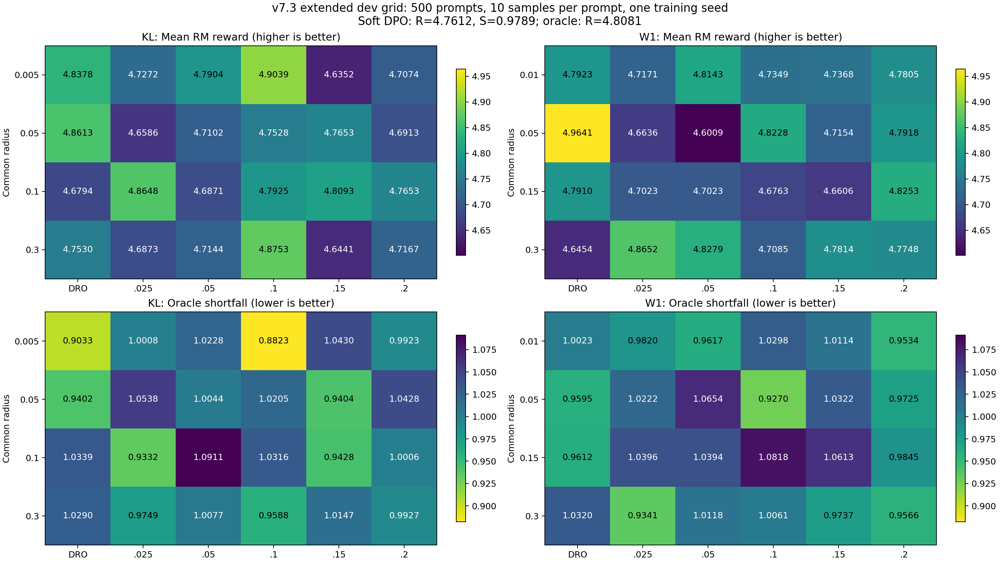

# v7.3 epsilon 扩展实验报告

绑定纲要 commit：`33136d47511f477cc0189a82c1e25ae98e805a71`。新增 epsilon=0.15、0.2 的 16 组 TRO 已完成训练、生成、RM 评分与核验，共 80,000 条。复用原 34 组并合并为 50 组、250,000 条。

本批是在查看首批开发集结果后登记的网格扩展。全部结果为单一 seed、500 道开发题，不属于独立 final test。

合并网格平均奖励最高：`w1_dro_r005`，R=4.964061；oracle 短缺最小：`kl_tro_r0005_e01`，S_O=0.882258。这是开发集描述性极值，不能作为独立显著性证明。

## 参数与执行

复用 Llama-3.2-1B-Instruct 起点与 Skywork-Reward-V2-Llama-3.1-8B。训练对/开发题=2000/500；N=1/3/5 对应800/600/600，共5600票；Beta(0.5,0.5)，T_pref=9.2548828125。allocation/vote/train/generation seed=1731/2101/1101/2101。

新增 epsilon=0.15/0.2，各与 KL rho=0.005/0.05/0.1/0.3、W1 rho=0.01/0.05/0.15/0.3 完整组合。每组独立从同一初始策略训练2 epochs；max_len=2048、lr=5e-7、beta=0.01、DP=2、microbatch=1、累积64、有效batch128；AdamW betas=(0.9,0.95)、weight_decay=0、warmup=0.1、clip=1；BF16、FP32 logprob/loss、ZeRO-2、gradient checkpointing、no-flash_attn。

每模型每题生成10条，temperature=0.7、top_p=0.9、max_new_tokens=1024、context=4096、vLLM utilization=0.4。RM BF16、responses模式、batch=2、max_length=4096。R为逐题均值的平均；S_O为逐题相对原oracle均值短缺的正部平均。配对bootstrap=2000、seed=601，单位为prompt。

训练到最后评分墙钟约 3.09 小时，包含等待、初始化与重试；不是 GPU 活跃计算时间。UTC 起止见 `../audit/timing.json`。

北京时间 2026-11-11 15:07:18 启动，18:12:59 完成最后评分，18:14:24 完成分析。16 组训练均首轮成功；`kl_tro_r03_e02` 的生成首次在 vLLM 初始化 KV cache 时显存不足，第二次成功，原始失败与重试日志已归档。

## 新增16组完整结果

| 配置 | rho | epsilon | R | R 95% CI | S_O | S_O 95% CI |
|---|---:|---:|---:|---|---:|---|
| kl_tro_r0005_e015 | 0.005 | 0.15 | 4.635233 | [3.692557, 5.592174] | 1.043041 | [0.914513, 1.182879] |
| kl_tro_r0005_e02 | 0.005 | 0.2 | 4.707361 | [3.772981, 5.702904] | 0.992311 | [0.866682, 1.129016] |
| kl_tro_r005_e015 | 0.05 | 0.15 | 4.765280 | [3.816724, 5.729411] | 0.940412 | [0.818096, 1.062059] |
| kl_tro_r005_e02 | 0.05 | 0.2 | 4.691291 | [3.735955, 5.674822] | 1.042807 | [0.910706, 1.182204] |
| kl_tro_r01_e015 | 0.1 | 0.15 | 4.809337 | [3.862616, 5.771407] | 0.942784 | [0.817546, 1.067637] |
| kl_tro_r01_e02 | 0.1 | 0.2 | 4.765344 | [3.835765, 5.747442] | 1.000552 | [0.868095, 1.142456] |
| kl_tro_r03_e015 | 0.3 | 0.15 | 4.644113 | [3.693001, 5.630054] | 1.014691 | [0.889597, 1.150138] |
| kl_tro_r03_e02 | 0.3 | 0.2 | 4.716667 | [3.772456, 5.678750] | 0.992680 | [0.870991, 1.123704] |
| w1_tro_r001_e015 | 0.01 | 0.15 | 4.736815 | [3.793139, 5.709425] | 1.011449 | [0.884919, 1.138476] |
| w1_tro_r001_e02 | 0.01 | 0.2 | 4.780497 | [3.828023, 5.773638] | 0.953358 | [0.834605, 1.080952] |
| w1_tro_r005_e015 | 0.05 | 0.15 | 4.715410 | [3.755834, 5.700222] | 1.032152 | [0.901351, 1.172514] |
| w1_tro_r005_e02 | 0.05 | 0.2 | 4.791805 | [3.853739, 5.766694] | 0.972459 | [0.849957, 1.109191] |
| w1_tro_r015_e015 | 0.15 | 0.15 | 4.660633 | [3.725534, 5.632215] | 1.061294 | [0.928075, 1.193468] |
| w1_tro_r015_e02 | 0.15 | 0.2 | 4.825278 | [3.880150, 5.795753] | 0.984496 | [0.855285, 1.117597] |
| w1_tro_r03_e015 | 0.3 | 0.15 | 4.781449 | [3.828375, 5.743643] | 0.973729 | [0.846545, 1.100712] |
| w1_tro_r03_e02 | 0.3 | 0.2 | 4.774828 | [3.821949, 5.745815] | 0.956557 | [0.834314, 1.087730] |

## 新增配对比较

ΔR=TRO−baseline，越大越好；ΔS_O=TRO−baseline，越小越好。区间未做多重比较校正。

| 配置 | baseline | ΔR | ΔR 95% CI | ΔS_O | ΔS_O 95% CI |
|---|---|---:|---|---:|---|
| kl_tro_r0005_e015 | kl_dro_r0005 | -0.202530 | [-0.426886, +0.005218] | +0.139740 | [+0.001161, +0.283012] |
| kl_tro_r0005_e015 | soft_dpo | -0.125956 | [-0.352931, +0.093338] | +0.064100 | [-0.083698, +0.201899] |
| kl_tro_r0005_e02 | kl_dro_r0005 | -0.130402 | [-0.325120, +0.075645] | +0.089010 | [-0.037673, +0.209021] |
| kl_tro_r0005_e02 | soft_dpo | -0.053828 | [-0.264038, +0.157574] | +0.013370 | [-0.131040, +0.156284] |
| kl_tro_r005_e015 | kl_dro_r005 | -0.095990 | [-0.316118, +0.124693] | +0.000248 | [-0.142905, +0.142195] |
| kl_tro_r005_e015 | soft_dpo | +0.004091 | [-0.204537, +0.217861] | -0.038529 | [-0.188004, +0.112607] |
| kl_tro_r005_e02 | kl_dro_r005 | -0.169980 | [-0.381016, +0.044748] | +0.102644 | [-0.032525, +0.239313] |
| kl_tro_r005_e02 | soft_dpo | -0.069898 | [-0.294636, +0.144461] | +0.063866 | [-0.078479, +0.209106] |
| kl_tro_r01_e015 | kl_dro_r01 | +0.129965 | [-0.079070, +0.353943] | -0.091106 | [-0.242899, +0.045641] |
| kl_tro_r01_e015 | soft_dpo | +0.048148 | [-0.161526, +0.266329] | -0.036157 | [-0.179644, +0.103018] |
| kl_tro_r01_e02 | kl_dro_r01 | +0.085972 | [-0.142590, +0.322323] | -0.033338 | [-0.184445, +0.121370] |
| kl_tro_r01_e02 | soft_dpo | +0.004155 | [-0.205425, +0.213300] | +0.021611 | [-0.117554, +0.160969] |
| kl_tro_r03_e015 | kl_dro_r03 | -0.108866 | [-0.335081, +0.110172] | -0.014279 | [-0.151702, +0.127731] |
| kl_tro_r03_e015 | soft_dpo | -0.117076 | [-0.338899, +0.105701] | +0.035750 | [-0.109445, +0.181665] |
| kl_tro_r03_e02 | kl_dro_r03 | -0.036312 | [-0.273396, +0.205107] | -0.036289 | [-0.196118, +0.124413] |
| kl_tro_r03_e02 | soft_dpo | -0.044522 | [-0.258138, +0.174086] | +0.013739 | [-0.121533, +0.151010] |
| w1_tro_r001_e015 | w1_dro_r001 | -0.055474 | [-0.261817, +0.155398] | +0.009154 | [-0.123719, +0.139106] |
| w1_tro_r001_e015 | soft_dpo | -0.024374 | [-0.238505, +0.192930] | +0.032508 | [-0.112692, +0.172504] |
| w1_tro_r001_e02 | w1_dro_r001 | -0.011792 | [-0.239782, +0.226608] | -0.048938 | [-0.194387, +0.099941] |
| w1_tro_r001_e02 | soft_dpo | +0.019308 | [-0.188295, +0.228136] | -0.025583 | [-0.163050, +0.112398] |
| w1_tro_r005_e015 | w1_dro_r005 | -0.248651 | [-0.482949, -0.010676] | +0.072638 | [-0.069167, +0.209848] |
| w1_tro_r005_e015 | soft_dpo | -0.045779 | [-0.260512, +0.176085] | +0.053211 | [-0.085422, +0.197032] |
| w1_tro_r005_e02 | w1_dro_r005 | -0.172257 | [-0.376934, +0.029188] | +0.012946 | [-0.122254, +0.148642] |
| w1_tro_r005_e02 | soft_dpo | +0.030616 | [-0.182793, +0.238777] | -0.006482 | [-0.143754, +0.131053] |
| w1_tro_r015_e015 | w1_dro_r015 | -0.130328 | [-0.335592, +0.080983] | +0.100064 | [-0.037106, +0.235121] |
| w1_tro_r015_e015 | soft_dpo | -0.100556 | [-0.314003, +0.102798] | +0.082353 | [-0.058469, +0.220737] |
| w1_tro_r015_e02 | w1_dro_r015 | +0.034317 | [-0.189336, +0.253146] | +0.023266 | [-0.115052, +0.161107] |
| w1_tro_r015_e02 | soft_dpo | +0.064089 | [-0.161625, +0.295243] | +0.005555 | [-0.148287, +0.149544] |
| w1_tro_r03_e015 | w1_dro_r03 | +0.136094 | [-0.083438, +0.354552] | -0.058245 | [-0.204313, +0.091125] |
| w1_tro_r03_e015 | soft_dpo | +0.020260 | [-0.184016, +0.221183] | -0.005212 | [-0.138088, +0.129007] |
| w1_tro_r03_e02 | w1_dro_r03 | +0.129473 | [-0.093474, +0.336470] | -0.075417 | [-0.227301, +0.069518] |
| w1_tro_r03_e02 | soft_dpo | +0.013639 | [-0.207140, +0.225688] | -0.022384 | [-0.153115, +0.109268] |

## 新增批次方向统计

| 距离 | baseline | 配置数 | ΔR>0 | ΔS_O<0 | 两者同时成立 |
|---|---|---:|---:|---:|---:|
| kl | same_radius_dro | 8 | 2 | 4 | 2 |
| kl | soft_dpo | 8 | 3 | 2 | 2 |
| w1 | same_radius_dro | 8 | 3 | 3 | 2 |
| w1 | soft_dpo | 8 | 5 | 4 | 4 |

## 合并50组结果

| 配置 | 批次 | rho | epsilon | R | S_O |
|---|---|---:|---:|---:|---:|
| soft_dpo | v7_dev_grid_20261110 | None | None | 4.761189 | 0.978941 |
| oracle_soft_dpo | v7_dev_grid_20261110 | None | None | 4.808071 | 0.000000 |
| kl_dro_r0005 | v7_dev_grid_20261110 | 0.005 | None | 4.837763 | 0.903301 |
| kl_tro_r0005_e0025 | v7_dev_grid_20261110 | 0.005 | 0.025 | 4.727220 | 1.000758 |
| kl_tro_r0005_e005 | v7_dev_grid_20261110 | 0.005 | 0.05 | 4.790368 | 1.022818 |
| kl_tro_r0005_e01 | v7_dev_grid_20261110 | 0.005 | 0.1 | 4.903892 | 0.882258 |
| kl_dro_r005 | v7_dev_grid_20261110 | 0.05 | None | 4.861270 | 0.940163 |
| kl_tro_r005_e0025 | v7_dev_grid_20261110 | 0.05 | 0.025 | 4.658596 | 1.053819 |
| kl_tro_r005_e005 | v7_dev_grid_20261110 | 0.05 | 0.05 | 4.710152 | 1.004438 |
| kl_tro_r005_e01 | v7_dev_grid_20261110 | 0.05 | 0.1 | 4.752805 | 1.020457 |
| kl_dro_r01 | v7_dev_grid_20261110 | 0.1 | None | 4.679372 | 1.033890 |
| kl_tro_r01_e0025 | v7_dev_grid_20261110 | 0.1 | 0.025 | 4.864783 | 0.933154 |
| kl_tro_r01_e005 | v7_dev_grid_20261110 | 0.1 | 0.05 | 4.687064 | 1.091107 |
| kl_tro_r01_e01 | v7_dev_grid_20261110 | 0.1 | 0.1 | 4.792487 | 1.031618 |
| kl_dro_r03 | v7_dev_grid_20261110 | 0.3 | None | 4.752979 | 1.028969 |
| kl_tro_r03_e0025 | v7_dev_grid_20261110 | 0.3 | 0.025 | 4.687265 | 0.974861 |
| kl_tro_r03_e005 | v7_dev_grid_20261110 | 0.3 | 0.05 | 4.714401 | 1.007700 |
| kl_tro_r03_e01 | v7_dev_grid_20261110 | 0.3 | 0.1 | 4.875254 | 0.958834 |
| w1_dro_r001 | v7_dev_grid_20261110 | 0.01 | None | 4.792289 | 1.002296 |
| w1_tro_r001_e0025 | v7_dev_grid_20261110 | 0.01 | 0.025 | 4.717126 | 0.981980 |
| w1_tro_r001_e005 | v7_dev_grid_20261110 | 0.01 | 0.05 | 4.814315 | 0.961666 |
| w1_tro_r001_e01 | v7_dev_grid_20261110 | 0.01 | 0.1 | 4.734851 | 1.029755 |
| w1_dro_r005 | v7_dev_grid_20261110 | 0.05 | None | 4.964061 | 0.959514 |
| w1_tro_r005_e0025 | v7_dev_grid_20261110 | 0.05 | 0.025 | 4.663600 | 1.022163 |
| w1_tro_r005_e005 | v7_dev_grid_20261110 | 0.05 | 0.05 | 4.600932 | 1.065390 |
| w1_tro_r005_e01 | v7_dev_grid_20261110 | 0.05 | 0.1 | 4.822750 | 0.926968 |
| w1_dro_r015 | v7_dev_grid_20261110 | 0.15 | None | 4.790961 | 0.961230 |
| w1_tro_r015_e0025 | v7_dev_grid_20261110 | 0.15 | 0.025 | 4.702291 | 1.039629 |
| w1_tro_r015_e005 | v7_dev_grid_20261110 | 0.15 | 0.05 | 4.702325 | 1.039408 |
| w1_tro_r015_e01 | v7_dev_grid_20261110 | 0.15 | 0.1 | 4.676287 | 1.081825 |
| w1_dro_r03 | v7_dev_grid_20261110 | 0.3 | None | 4.645356 | 1.031974 |
| w1_tro_r03_e0025 | v7_dev_grid_20261110 | 0.3 | 0.025 | 4.865209 | 0.934089 |
| w1_tro_r03_e005 | v7_dev_grid_20261110 | 0.3 | 0.05 | 4.827911 | 1.011848 |
| w1_tro_r03_e01 | v7_dev_grid_20261110 | 0.3 | 0.1 | 4.708506 | 1.006126 |
| kl_tro_r0005_e015 | v73_epsilon_extension_20261111 | 0.005 | 0.15 | 4.635233 | 1.043041 |
| kl_tro_r0005_e02 | v73_epsilon_extension_20261111 | 0.005 | 0.2 | 4.707361 | 0.992311 |
| kl_tro_r005_e015 | v73_epsilon_extension_20261111 | 0.05 | 0.15 | 4.765280 | 0.940412 |
| kl_tro_r005_e02 | v73_epsilon_extension_20261111 | 0.05 | 0.2 | 4.691291 | 1.042807 |
| kl_tro_r01_e015 | v73_epsilon_extension_20261111 | 0.1 | 0.15 | 4.809337 | 0.942784 |
| kl_tro_r01_e02 | v73_epsilon_extension_20261111 | 0.1 | 0.2 | 4.765344 | 1.000552 |
| kl_tro_r03_e015 | v73_epsilon_extension_20261111 | 0.3 | 0.15 | 4.644113 | 1.014691 |
| kl_tro_r03_e02 | v73_epsilon_extension_20261111 | 0.3 | 0.2 | 4.716667 | 0.992680 |
| w1_tro_r001_e015 | v73_epsilon_extension_20261111 | 0.01 | 0.15 | 4.736815 | 1.011449 |
| w1_tro_r001_e02 | v73_epsilon_extension_20261111 | 0.01 | 0.2 | 4.780497 | 0.953358 |
| w1_tro_r005_e015 | v73_epsilon_extension_20261111 | 0.05 | 0.15 | 4.715410 | 1.032152 |
| w1_tro_r005_e02 | v73_epsilon_extension_20261111 | 0.05 | 0.2 | 4.791805 | 0.972459 |
| w1_tro_r015_e015 | v73_epsilon_extension_20261111 | 0.15 | 0.15 | 4.660633 | 1.061294 |
| w1_tro_r015_e02 | v73_epsilon_extension_20261111 | 0.15 | 0.2 | 4.825278 | 0.984496 |
| w1_tro_r03_e015 | v73_epsilon_extension_20261111 | 0.3 | 0.15 | 4.781449 | 0.973729 |
| w1_tro_r03_e02 | v73_epsilon_extension_20261111 | 0.3 | 0.2 | 4.774828 | 0.956557 |

## 核验与限制

- 已复核初始模型、RM、tokenizer、实际执行源码及复用参照的 SHA256；冻结输入未重新抽票。新增输入仅修改epsilon和lambda。后验数值表、对称、单调、范围拒绝和实际trainer loss/梯度检查通过。
- 新增80000条均具备完整500题×10条，prompt/response与生成文件一致，分数有限；按原RM模板重新计算不截断输入长度，全部不超过4096。
- 新增模型均完成两轮、每rank2000 microstep，实际DP=2、累积64。沿用旧trainer：31个完整更新、scheduler计划30、末尾32对累积梯度未提交。核验依据为实际日志与未改动实现，见training_budget_checks.json。
- 旧34组结果与原归档指标逐项复算一致。旧批次的失败重试、尾批等偏差仍见原报告，未因合并而抹去。新增失败重试保留在本轮日志。
- 本轮只有一个投票/训练seed；置信区间反映prompt间变异，不覆盖重训、重新投票和观察结果后的网格扩展。未启动final test、人数增长或先验敏感性训练。
- 沿用原生成实现，未记录finish_reason，不能精确汇报达到max_new_tokens的比例。

## 交付文件

- extension_results.csv / extension_comparisons.csv：新增16行结果与32行比较。
- combined_results.csv / combined_comparisons.csv：合并50行参数结果与80行比较，注明来源批次及纲要commit。
- extension_prompt_scores.csv / combined_prompt_scores.csv：新增与合并逐题分数。
- length_audit.csv、后验/区间诊断表、PNG/PDF图、../audit/、../run_metadata.json：核验、参数、hash及耗时。
- `../raw_results/`：全部新增评分、生成、原始日志、实际输入、模型配置及 tokenizer 的分卷归档；恢复说明见 `../README.md`，逐文件 hash 见 `../RAW_RESULTS_MANIFEST.json`。
- 模型权重与优化器 checkpoint：服务器 `/mnt/hezhisheng/su/experiment_v73_20261111`，最终权重 hash 见 `../audit/model_exports.json`。旧 34 组完整评分与归档仍位于仓库 `../../v7_dev_grid_20261110/`。
