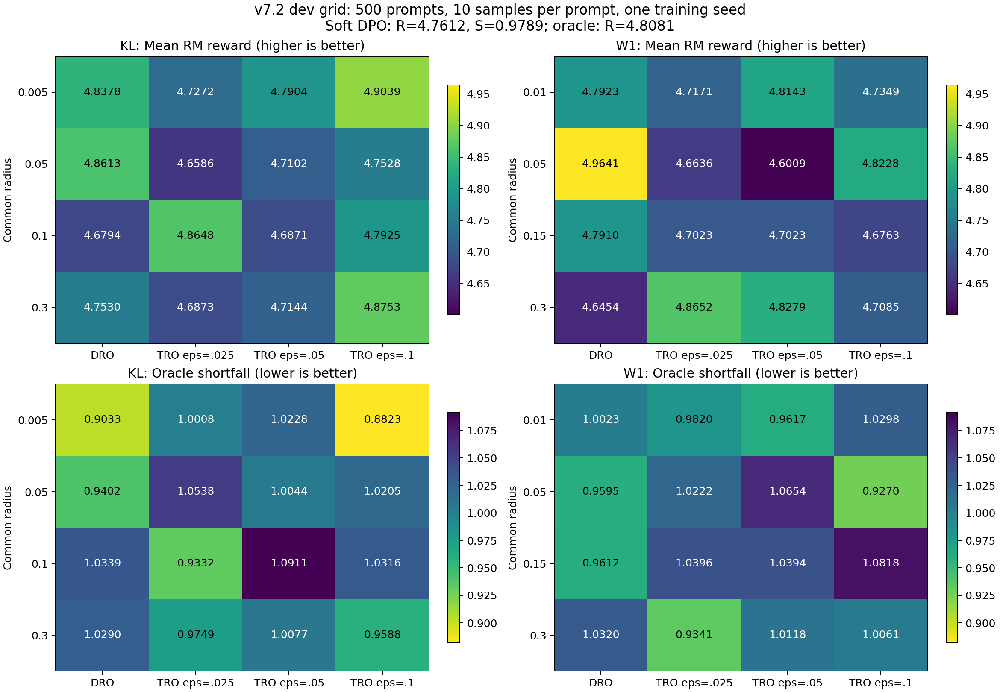

# v7.2 KL / W1 全网格开发集实验报告

协议 commit：`7beb6b4`；生成时间：2026-11-10T14:37:35.064652+00:00。

**运行范围：34/34 个配置完成训练、生成和评分。每个配置 500 道相同开发题，每题 10 个生成，共 170,000 条评分。**

完整训练开始 2026-11-10T09:14:49.382329+00:00，最后模型导出 2026-11-10T12:05:35+00:00，最后评分写入 2026-11-10T14:36:47+00:00；训练到评分合计 5.37 小时（含初始化、等待、失败与补跑），训练阶段 2.85 小时，随后评测阶段 2.52 小时。未测量 GPU 实际算力利用小时。

除 oracle 参照外，平均奖励最高为 `w1_dro_r005`：4.964061；oracle 短缺最小为 `kl_tro_r0005_e01`：0.882258。这些是开发集描述性排序。

平均奖励最高和短缺最小对应不同配置；TRO 没有在全网格一致胜出。短缺最小的 KL-TRO（rho=0.005，epsilon=0.1）相对 soft DPO 的 ΔR=+0.142703、ΔS_O=−0.096683；配对 95% CI 分别为 [−0.067111, +0.357714] 和 [−0.239972, +0.048395]，均跨 0，不能据此断言有稳定提升。

## 参数与数据

| 参数 | 实际值 |
|---|---|
| 数据源 revision | HuggingFaceH4/ultrafeedback_binarized@3949bf5f8c17c394422ccfab0c31ea9c20bdeb85；沿用已冻结回答对和 RM 分数 |
| 实现代码 | 基于 d6dc68bbaaa51c60b7d1b6ccd991fc6fbc72de4e 的工作区；包含未提交的 trainer 文件，确切源码与 hash 见 audit，不能仅用该 commit 复现 |
| 模型 / 参考模型 | Llama-3.2-1B-Instruct，同初始化、冻结参考 |
| oracle / 评测 RM | Skywork/Skywork-Reward-V2-Llama-3.1-8B，BF16 |
| 固定数据 | 2000 train pairs；500 dev prompts；无 prompt 重叠 |
| N_i 与配额 | 1/3/5：800/600/600 对（40%/30%/30%）；共 5600 票 |
| allocation / vote / train / generation seeds | 1731 / 2101 / 1101 / 2101 |
| 偏好温度 | T_pref=9.2548828125，训练集非零绝对 RM 分差中位数 |
| 后验先验 / epsilon | Beta(0.5,0.5) / {0.025,0.05,0.1} |
| KL 半径 | {0.005,0.05,0.1,0.3}；KL(Ber(h) || Ber(p)) |
| W1 半径 | {0.01,0.05,0.15,0.3}；d(0,1)=1 |
| 优化 | 2 epochs；lr=5e-7；beta=0.01；AdamW betas=(0.9,0.95)，wd=0，warmup=0.1，clip=1 |
| 并行 / batch | ZeRO-2，DP=2，每卡 microbatch=1，累积=64，有效 batch=128 |
| 数值 / 长度 | BF16 模型，FP32 logprob/loss；训练每侧 max_len=2048，完整回答对 |
| 生成 | G=10，temperature=0.7，top_p=0.9，max_new_tokens=1024，context=4096，vLLM memory utilization=0.4 |
| 评分 | responses 模式，batch=2，max_length=4096，实际完整文本无截断 |
| 预算 | 每配置 5000 条；全网格 170000 条；单次投票/训练/生成 seed |

图中 KL 与 W1 共用各指标的色标；不同距离的同数值半径不代表等强度集合。

## 完整结果

R 为 500 道题各自 10 次奖励均值的平均；S_O=mean_i max(R_oracle,i-R_method,i,0)，越小越好。Oracle policy 是精确概率标签训练的参照，不是理论上界。

| 配置 | 距离 | rho | epsilon | R ↑ | S_O ↓ | S_O 95% CI |
|---|---|---:|---:|---:|---:|---|
| soft_dpo | — | — | — | 4.761189 | 0.978941 | [0.852056, 1.110186] |
| oracle_soft_dpo | — | — | — | 4.808071 | 0.000000 | [0.000000, 0.000000] |
| kl_dro_r0005 | kl | 0.005 | — | 4.837763 | 0.903301 | [0.789731, 1.019630] |
| kl_tro_r0005_e0025 | kl | 0.005 | 0.025 | 4.727220 | 1.000758 | [0.866501, 1.153174] |
| kl_tro_r0005_e005 | kl | 0.005 | 0.05 | 4.790368 | 1.022818 | [0.888043, 1.166243] |
| kl_tro_r0005_e01 | kl | 0.005 | 0.1 | 4.903892 | 0.882258 | [0.754004, 1.015473] |
| kl_dro_r005 | kl | 0.05 | — | 4.861270 | 0.940163 | [0.821741, 1.073750] |
| kl_tro_r005_e0025 | kl | 0.05 | 0.025 | 4.658596 | 1.053819 | [0.921400, 1.192499] |
| kl_tro_r005_e005 | kl | 0.05 | 0.05 | 4.710152 | 1.004438 | [0.876063, 1.143476] |
| kl_tro_r005_e01 | kl | 0.05 | 0.1 | 4.752805 | 1.020457 | [0.889688, 1.153407] |
| kl_dro_r01 | kl | 0.1 | — | 4.679372 | 1.033890 | [0.898796, 1.173648] |
| kl_tro_r01_e0025 | kl | 0.1 | 0.025 | 4.864783 | 0.933154 | [0.818087, 1.053860] |
| kl_tro_r01_e005 | kl | 0.1 | 0.05 | 4.687064 | 1.091107 | [0.947064, 1.238526] |
| kl_tro_r01_e01 | kl | 0.1 | 0.1 | 4.792487 | 1.031618 | [0.893703, 1.181071] |
| kl_dro_r03 | kl | 0.3 | — | 4.752979 | 1.028969 | [0.884264, 1.182008] |
| kl_tro_r03_e0025 | kl | 0.3 | 0.025 | 4.687265 | 0.974861 | [0.861473, 1.091062] |
| kl_tro_r03_e005 | kl | 0.3 | 0.05 | 4.714401 | 1.007700 | [0.872795, 1.151088] |
| kl_tro_r03_e01 | kl | 0.3 | 0.1 | 4.875254 | 0.958834 | [0.826401, 1.101650] |
| w1_dro_r001 | w1 | 0.01 | — | 4.792289 | 1.002296 | [0.876503, 1.135208] |
| w1_tro_r001_e0025 | w1 | 0.01 | 0.025 | 4.717126 | 0.981980 | [0.855493, 1.118972] |
| w1_tro_r001_e005 | w1 | 0.01 | 0.05 | 4.814315 | 0.961666 | [0.832792, 1.097908] |
| w1_tro_r001_e01 | w1 | 0.01 | 0.1 | 4.734851 | 1.029755 | [0.888414, 1.166236] |
| w1_dro_r005 | w1 | 0.05 | — | 4.964061 | 0.959514 | [0.828003, 1.107000] |
| w1_tro_r005_e0025 | w1 | 0.05 | 0.025 | 4.663600 | 1.022163 | [0.892908, 1.159454] |
| w1_tro_r005_e005 | w1 | 0.05 | 0.05 | 4.600932 | 1.065390 | [0.941995, 1.204501] |
| w1_tro_r005_e01 | w1 | 0.05 | 0.1 | 4.822750 | 0.926968 | [0.811556, 1.045744] |
| w1_dro_r015 | w1 | 0.15 | — | 4.790961 | 0.961230 | [0.836791, 1.097520] |
| w1_tro_r015_e0025 | w1 | 0.15 | 0.025 | 4.702291 | 1.039629 | [0.901231, 1.182903] |
| w1_tro_r015_e005 | w1 | 0.15 | 0.05 | 4.702325 | 1.039408 | [0.903125, 1.179777] |
| w1_tro_r015_e01 | w1 | 0.15 | 0.1 | 4.676287 | 1.081825 | [0.937302, 1.229480] |
| w1_dro_r03 | w1 | 0.3 | — | 4.645356 | 1.031974 | [0.893868, 1.181420] |
| w1_tro_r03_e0025 | w1 | 0.3 | 0.025 | 4.865209 | 0.934089 | [0.813037, 1.058912] |
| w1_tro_r03_e005 | w1 | 0.3 | 0.05 | 4.827911 | 1.011848 | [0.881305, 1.153564] |
| w1_tro_r03_e01 | w1 | 0.3 | 0.1 | 4.708506 | 1.006126 | [0.870401, 1.142641] |

## TRO 相对基线的配对比较

ΔR=TRO−baseline 越大越好；ΔS_O=TRO−baseline 越小越好。95% CI 按共同 prompt 配对 bootstrap 2000 次，seed=601；未作多重比较校正。

| TRO 配置 | baseline | ΔR | ΔR 95% CI | ΔS_O | ΔS_O 95% CI |
|---|---|---:|---|---:|---|
| kl_tro_r0005_e0025 | kl_dro_r0005 | -0.110544 | [-0.323438, +0.088789] | +0.097457 | [-0.029868, +0.243623] |
| kl_tro_r0005_e0025 | soft_dpo | -0.033969 | [-0.246575, +0.173947] | +0.021817 | [-0.111159, +0.169370] |
| kl_tro_r0005_e005 | kl_dro_r0005 | -0.047395 | [-0.274383, +0.190282] | +0.119516 | [-0.023475, +0.259702] |
| kl_tro_r0005_e005 | soft_dpo | +0.029179 | [-0.186859, +0.245385] | +0.043876 | [-0.103531, +0.194027] |
| kl_tro_r0005_e01 | kl_dro_r0005 | +0.066128 | [-0.154924, +0.281874] | -0.021043 | [-0.161929, +0.120238] |
| kl_tro_r0005_e01 | soft_dpo | +0.142703 | [-0.067111, +0.357714] | -0.096683 | [-0.239972, +0.048395] |
| kl_tro_r005_e0025 | kl_dro_r005 | -0.202674 | [-0.434198, +0.018902] | +0.113656 | [-0.025239, +0.254316] |
| kl_tro_r005_e0025 | soft_dpo | -0.102593 | [-0.328462, +0.121511] | +0.074878 | [-0.072767, +0.215357] |
| kl_tro_r005_e005 | kl_dro_r005 | -0.151119 | [-0.386868, +0.067248] | +0.064274 | [-0.085232, +0.214435] |
| kl_tro_r005_e005 | soft_dpo | -0.051037 | [-0.261682, +0.154724] | +0.025497 | [-0.116832, +0.163613] |
| kl_tro_r005_e01 | kl_dro_r005 | -0.108465 | [-0.330379, +0.103414] | +0.080294 | [-0.051145, +0.214858] |
| kl_tro_r005_e01 | soft_dpo | -0.008384 | [-0.218898, +0.195458] | +0.041516 | [-0.102318, +0.179119] |
| kl_tro_r01_e0025 | kl_dro_r01 | +0.185411 | [-0.032070, +0.387008] | -0.100736 | [-0.235564, +0.039337] |
| kl_tro_r01_e0025 | soft_dpo | +0.103594 | [-0.114162, +0.308448] | -0.045787 | [-0.179682, +0.085420] |
| kl_tro_r01_e005 | kl_dro_r01 | +0.007692 | [-0.196241, +0.235997] | +0.057217 | [-0.087082, +0.202397] |
| kl_tro_r01_e005 | soft_dpo | -0.074125 | [-0.289205, +0.160115] | +0.112166 | [-0.041569, +0.257405] |
| kl_tro_r01_e01 | kl_dro_r01 | +0.113115 | [-0.111849, +0.336504] | -0.002272 | [-0.148224, +0.150624] |
| kl_tro_r01_e01 | soft_dpo | +0.031298 | [-0.189021, +0.250438] | +0.052677 | [-0.086434, +0.195642] |
| kl_tro_r03_e0025 | kl_dro_r03 | -0.065715 | [-0.279167, +0.156982] | -0.054108 | [-0.204108, +0.089308] |
| kl_tro_r03_e0025 | soft_dpo | -0.073924 | [-0.272917, +0.128723] | -0.004080 | [-0.127331, +0.121407] |
| kl_tro_r03_e005 | kl_dro_r03 | -0.038578 | [-0.257341, +0.191123] | -0.021270 | [-0.160579, +0.123626] |
| kl_tro_r03_e005 | soft_dpo | -0.046788 | [-0.252714, +0.175038] | +0.028758 | [-0.121494, +0.161671] |
| kl_tro_r03_e01 | kl_dro_r03 | +0.122274 | [-0.113794, +0.357756] | -0.070136 | [-0.223621, +0.080194] |
| kl_tro_r03_e01 | soft_dpo | +0.114065 | [-0.111593, +0.336845] | -0.020108 | [-0.160243, +0.124863] |
| w1_tro_r001_e0025 | w1_dro_r001 | -0.075163 | [-0.285413, +0.128738] | -0.020316 | [-0.150310, +0.115889] |
| w1_tro_r001_e0025 | soft_dpo | -0.044064 | [-0.260202, +0.164802] | +0.003039 | [-0.148994, +0.148982] |
| w1_tro_r001_e005 | w1_dro_r001 | +0.022027 | [-0.191299, +0.236407] | -0.040630 | [-0.163513, +0.083486] |
| w1_tro_r001_e005 | soft_dpo | +0.053126 | [-0.157883, +0.257632] | -0.017275 | [-0.154935, +0.113010] |
| w1_tro_r001_e01 | w1_dro_r001 | -0.057438 | [-0.292420, +0.170941] | +0.027460 | [-0.115029, +0.168335] |
| w1_tro_r001_e01 | soft_dpo | -0.026338 | [-0.246068, +0.217539] | +0.050814 | [-0.103249, +0.193988] |
| w1_tro_r005_e0025 | w1_dro_r005 | -0.300462 | [-0.541205, -0.058670] | +0.062649 | [-0.095159, +0.219389] |
| w1_tro_r005_e0025 | soft_dpo | -0.097589 | [-0.322692, +0.112936] | +0.043222 | [-0.093535, +0.178768] |
| w1_tro_r005_e005 | w1_dro_r005 | -0.363130 | [-0.581308, -0.139810] | +0.105876 | [-0.039381, +0.249884] |
| w1_tro_r005_e005 | soft_dpo | -0.160257 | [-0.363025, +0.042436] | +0.086449 | [-0.045917, +0.221168] |
| w1_tro_r005_e01 | w1_dro_r005 | -0.141311 | [-0.375555, +0.094561] | -0.032545 | [-0.173395, +0.101715] |
| w1_tro_r005_e01 | soft_dpo | +0.061561 | [-0.151145, +0.270777] | -0.051973 | [-0.191823, +0.081182] |
| w1_tro_r015_e0025 | w1_dro_r015 | -0.088670 | [-0.310065, +0.141423] | +0.078398 | [-0.069555, +0.232611] |
| w1_tro_r015_e0025 | soft_dpo | -0.058898 | [-0.273840, +0.160251] | +0.060688 | [-0.081493, +0.212587] |
| w1_tro_r015_e005 | w1_dro_r015 | -0.088636 | [-0.314318, +0.149084] | +0.078178 | [-0.073554, +0.232622] |
| w1_tro_r015_e005 | soft_dpo | -0.058864 | [-0.269865, +0.154199] | +0.060467 | [-0.084763, +0.201789] |
| w1_tro_r015_e01 | w1_dro_r015 | -0.114673 | [-0.334284, +0.099902] | +0.120595 | [-0.026572, +0.261088] |
| w1_tro_r015_e01 | soft_dpo | -0.084902 | [-0.324048, +0.143275] | +0.102884 | [-0.048467, +0.256597] |
| w1_tro_r03_e0025 | w1_dro_r03 | +0.219853 | [-0.007497, +0.458159] | -0.097886 | [-0.252808, +0.055872] |
| w1_tro_r03_e0025 | soft_dpo | +0.104020 | [-0.117588, +0.336547] | -0.044853 | [-0.190097, +0.100035] |
| w1_tro_r03_e005 | w1_dro_r03 | +0.182556 | [-0.060148, +0.408922] | -0.020126 | [-0.176294, +0.146501] |
| w1_tro_r03_e005 | soft_dpo | +0.066722 | [-0.144399, +0.275220] | +0.032907 | [-0.101693, +0.168704] |
| w1_tro_r03_e01 | w1_dro_r03 | +0.063151 | [-0.173581, +0.298514] | -0.025848 | [-0.183997, +0.133983] |
| w1_tro_r03_e01 | soft_dpo | -0.052683 | [-0.283681, +0.161495] | +0.027185 | [-0.124032, +0.185034] |

## 观察到的方向

| 距离 | 对比 | 配置数 | ΔR>0 | ΔS_O<0 | 两者同时成立 |
|---|---|---:|---:|---:|---:|
| kl | same_radius_dro | 12 | 5 | 6 | 4 |
| kl | soft_dpo | 12 | 5 | 4 | 3 |
| w1 | same_radius_dro | 12 | 4 | 6 | 4 |
| w1 | soft_dpo | 12 | 4 | 3 | 3 |

## 验证、运行异常与解释范围

- 输入审计通过：训练与 dev 无重复 prompt；实际训练每侧最长 1866 tokens；dev 最长模板 prompt 为 1174 tokens，生成预算在 4096 context 内。
- 所有 170000 条生成逐条核验：sample_id 0…9 唯一且齐全；RM 实际完整输入最长 2063 tokens，无 RM 截断，全部奖励有限。
- 数学审计通过：KL/W1 端点、lambda 与协议参考表一致、标签交换对称、跨半径权重不变，以及 loss/梯度和退化关系。普通训练数据 p_star 为占位值 0.5，实际 p_star 只用于投票模拟与 oracle trainer。
- 继承原 trainer 的尾批策略：每 rank 每 epoch 1000 个 microstep，累积跨 epoch 延续；4000 次回答对曝光对应 31 个完整 optimizer update（3968 对），末尾 32 对的累积未提交；scheduler 计划 30 update，实际 31。所有配置一致。这是本轮相对严格 4000 对更新预算的偏差，未在结果出来后修改。
- 首轮外部 vLLM 显存占用，以及原线程队列可能把不同配置重叠分配到同一组 GPU，导致初始化 OOM；7 个配置以相同数据和训练 seed 从初始化重新训练成功，补跑使用 GPU 1,3。调度代码已修正为固定每组 GPU 串行队列。另有成功训练被错误路径检查标为 failed，已保留原始状态并按成功日志/模型导出纠正。
- 生成/评分脚本最初有路径错误，生成默认 KV cache 也发生 OOM；已纠正路径并使用 vLLM utilization=0.4 完成，两个基线保留完整生成并单独补评分。原始失败及补跑日志保留。
- dev 额外生成了投票字段用于 trainer 内部的 dev loss，正式生成指标完全不依赖这些字段。该实现与协议“开发生成不分配人数”文字存在差异，但未改变 500 道题、生成或 RM 指标。
- 原生成脚本未保存 vLLM finish_reason，无法精确回报达到 max_new_tokens 的比例；不将长度估计冒充精确统计。
- 置信区间反映本次已生成样本在 prompt 间的变异；不覆盖重新抽票、训练随机性及多重选参。当前只有一次 seed 重复，500 题属于开发集，不能当作独立测试证明。没有读取或启动 final test；人数增长及先验敏感性训练不属于本轮 34 配置网格。

## 交付文件

- `dev_grid_results.csv`：34 行完整参数与结果。
- `tro_baseline_comparisons.csv`：48 行相对同半径 DRO / soft DPO 的配对差值及区间。
- `prompt_scores.csv`：17000 行配置×prompt 平均奖励及短缺。
- `length_audit.csv`、`vote_patterns.csv`：逐配置完整输入长度与票型数量。
- `posterior_vote_patterns.csv`、`lambda_distributions.csv`、`effective_interval_widths.csv`：票型与后验权重、分组分布和收缩区间宽度。
- `dev_grid_heatmap.png` / `.pdf`：全网格结果图。
- `../raw_results/`：全部逐生成完整回答及 RM 分数、原始日志、实际输入与模型配置的分卷归档；按 `../README.md` 恢复后路径为 `restored/eval/<config>/scored.jsonl`。模型权重保留在共享服务器，位置与 hash 见 `../audit/model_exports.json`。
- `../v7_grid_manifest.json`、`../run_metadata.json`、`../audit/`：冻结配置、种子、源代码快照与校验。
- `../train_status.json`、`../eval_status.json`：最终状态；原始训练状态保留在 `../audit/train_initial_attempt_status.json`。
